# 🛠️ [E1-1] 내 컴퓨터에 개발자용 '작업실' 꾸미기

본 프로젝트는 Docker를 이용한 웹 서버 환경 구축과 Git을 이용한 버전 관리의 기초를 실습하고, 데이터의 영속성을 확보하는 과정을 기록한 문서입니다.

## 1. 프로젝트 개요
- **목표**: 도커를 활용해 독립된 개발 환경을 구축하고, 커스텀 웹 서버 이미지를 만들어 배포하며, Git으로 전체 과정을 기록한다.
- **핵심 성과**: Dockerfile 기반 이미지 빌드, 포트 매핑(다중 포트), 바인드 마운트, 도커 볼륨 실습 완료.

## 2. 실행 환경
- **OS**: Windows 11
- **터미널**: PowerShell 7.4.6, Git Bash (UCRT64)
- **Docker**: Docker Desktop (Engine version 27.2.0)
- **Git**: Git for Windows (user: SangboonLim)

## 3. 수행 항목 체크리스트
- ✅ 터미널 기본 조작 (ls, cd, mkdir, rm 등)
- ✅ 파일 권한 실습 (chmod 600, 700을 이용한 권한 변경)
- ✅ Docker 설치 및 hello-world 실행 확인
- ✅ Ubuntu 컨테이너 진입 및 OS 정보 확인
- ✅ Dockerfile을 이용한 커스텀 Nginx 이미지(`my-web`) 제작
- ✅ 다중 포트 매핑 (8080, 8081) 및 브라우저 접속 확인
- ✅ 바인드 마운트(Bind Mount)를 통한 호스트-컨테이너 파일 동기화
- ✅ 도커 볼륨(Volume)을 이용한 데이터 영속성 검증
- ✅ Git 사용자 설정 및 기본 브랜치(main) 설정

## 4. 단계별 수행 기록 및 검증

### 4.1 터미널 조작 및 권한 실습
- **내용**: Ubuntu 컨테이너 내에서 `temp` 디렉토리를 생성하고 파일 권한을 변경함.
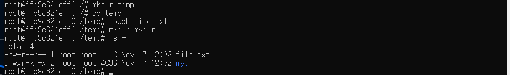
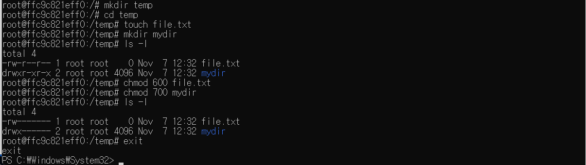
- **검증**: `ls -l` 명령을 통해 `file.txt`는 `600(-rw-------)`, `mydir`은 `700(drwx------)`으로 변경된 것을 확인.

### 4.2 Docker 기본 운영 및 컨테이너 생명주기
- **기본 실행**: `hello-world` 이미지를 통해 도커 엔진 작동 확인 및 Ubuntu 24.04 LTS 환경 진입.
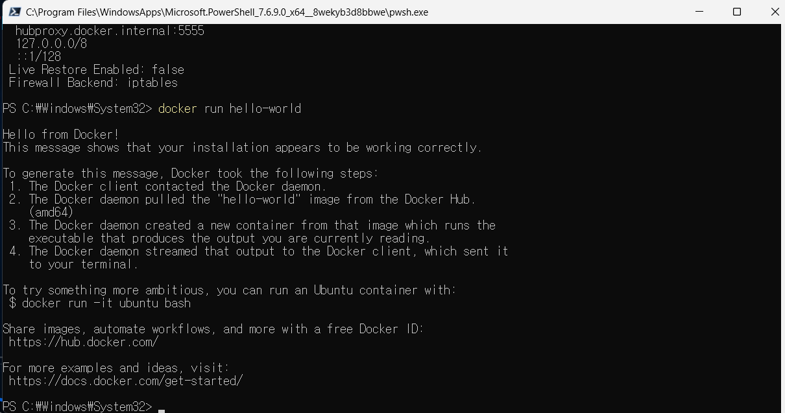
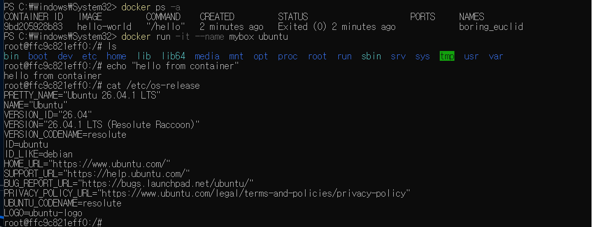
- **생명주기 및 모니터링**: 중지된 컨테이너를 재시작(`start`)하고, `stats` 및 `logs` 명령어로 리소스 상태를 점검함.
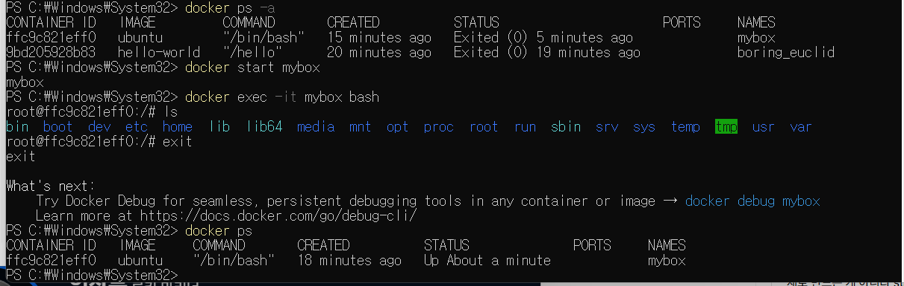
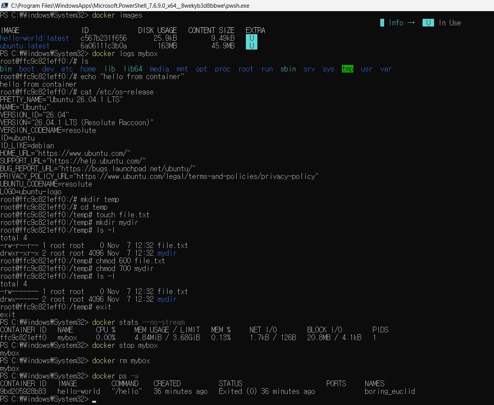

### 4.3 커스텀 웹 서버 이미지 제작 및 배포
- **이미지 빌드**: `Dockerfile`을 작성하여 `my-web` 이미지 빌드 성공.
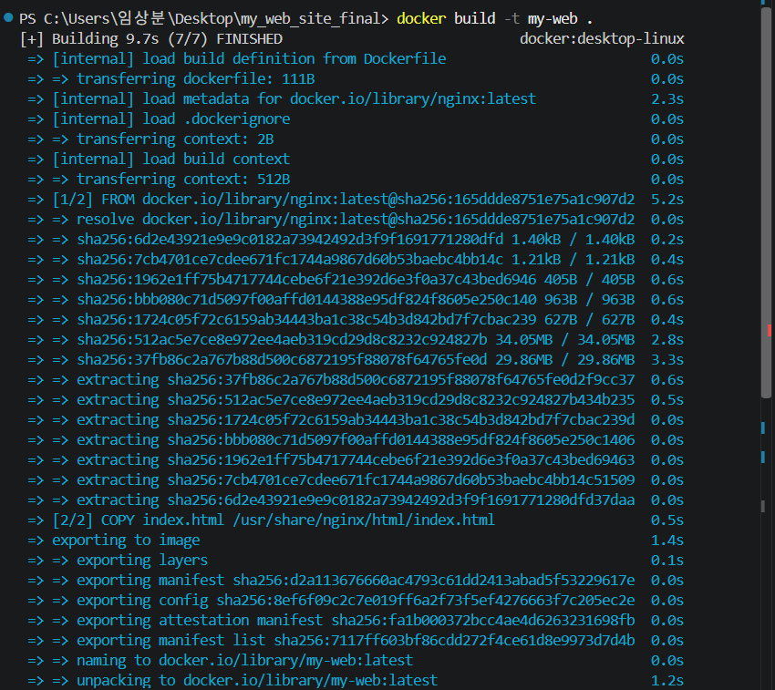
- **포트 매핑 및 실행**: 8080, 8081 포트에 각각 컨테이너를 배치하여 다중 서비스 운영 확인.
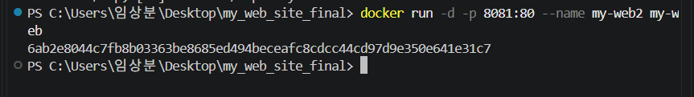
- **접속 결과**: 브라우저에서 `localhost:8080`, `localhost:8081` 모두 정상 접속 확인.
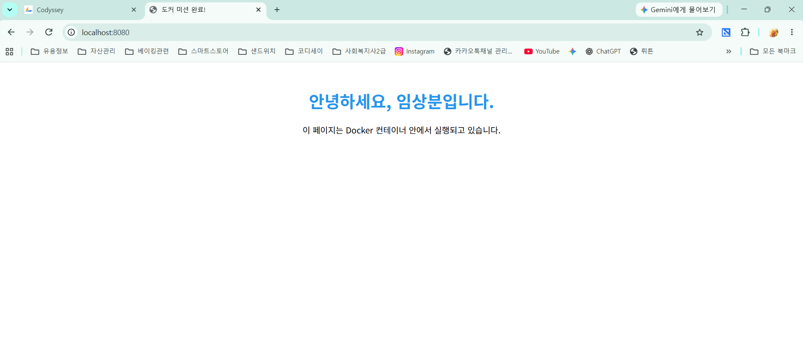
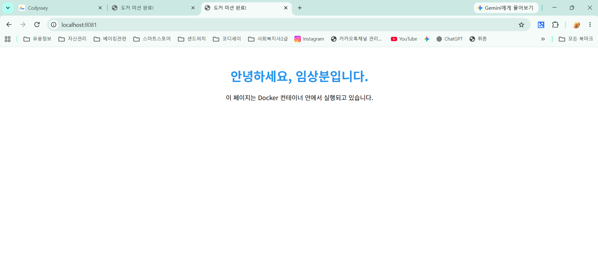

### 4.4 데이터 관리 (마운트 및 볼륨)
- **바인드 마운트**: 로컬의 `index.html`을 컨테이너에 연결하여 코드 수정 사항을 실시간 반영.
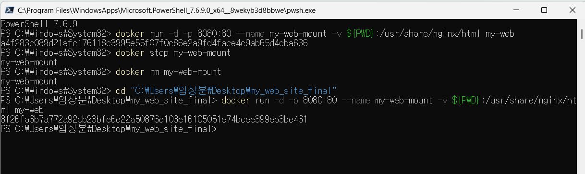
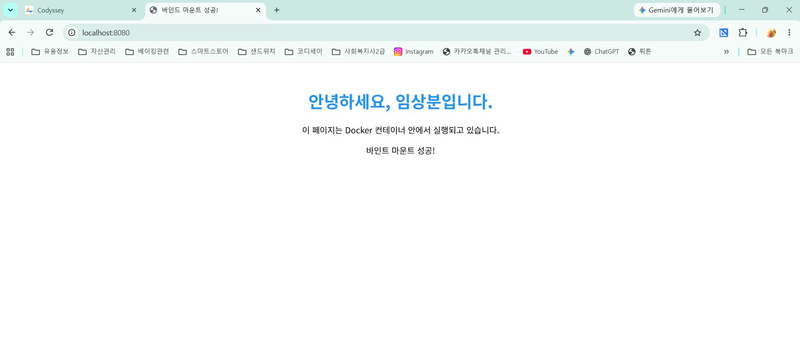
- **볼륨 영속성**: `mydata` 볼륨을 사용하여 컨테이너 삭제 후에도 데이터가 유지됨을 검증.
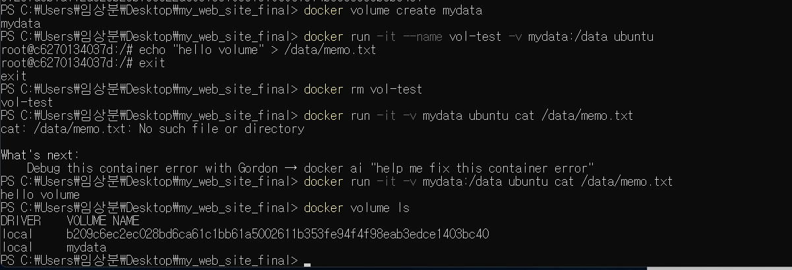

### 4.5 Git 설정
- **사용자 정보**: `SangboonLim` 계정 설정 및 기본 브랜치(`main`) 확인.
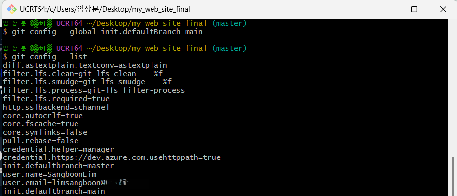

## 5. 트러블슈팅 (문제 해결 과정)

### ✅ 사례 1: Docker Run 명령어 인자 누락
- **문제**: 컨테이너 실행 시 `requires at least 1 argument` 에러 발생.
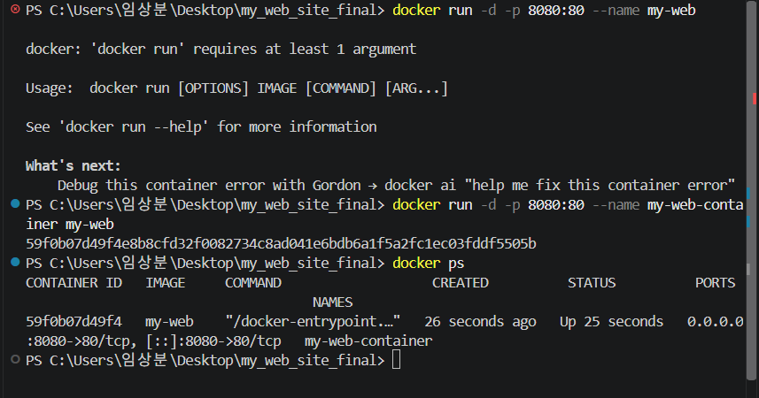
- **원인**: `--name` 옵션 뒤에 이미지 이름을 명시하지 않음.
- **해결**: 명령어 끝에 이미지 이름(`my-web`)을 추가하여 해결.

### ✅ 사례 2: 볼륨 데이터 확인 과정의 시행착오
- **문제**: 컨테이너 재실행 후 데이터가 즉시 보이지 않는 현상 발생.
- **해결**: 마운트 경로(`/data/memo.txt`)를 정확히 확인하고 볼륨 연결 옵션을 재점검하여 데이터 복구 확인(이미지 15번 참조).

## 6. 재실행 방법
1. `docker build -t my-web .`
2. `docker run -d -p 8080:80 --name my-web-container my-web`
3. 브라우저에서 `localhost:8080` 접속.

