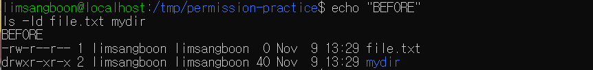
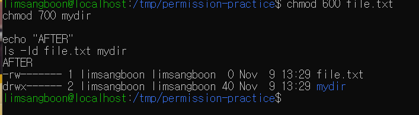
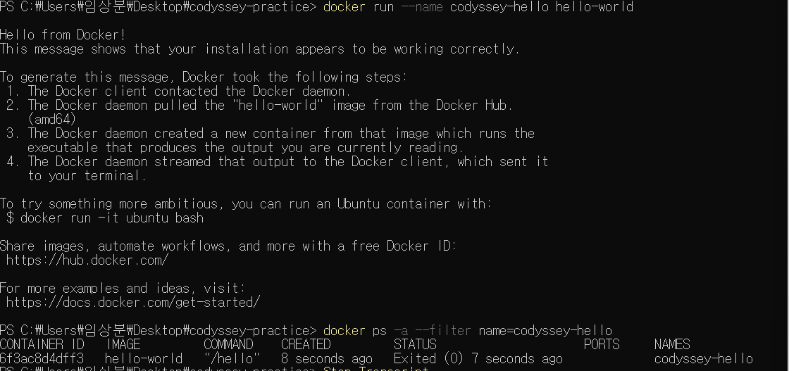
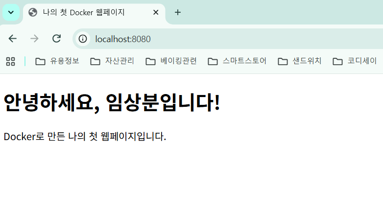
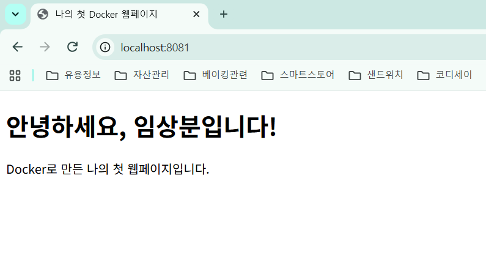
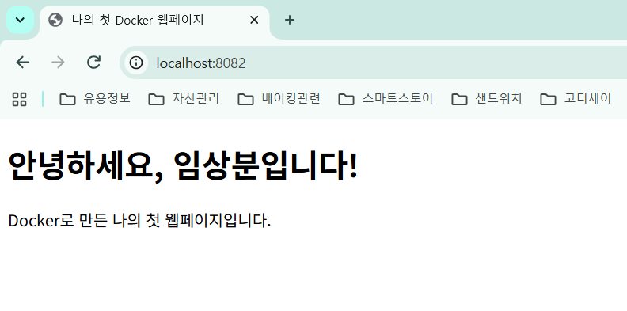
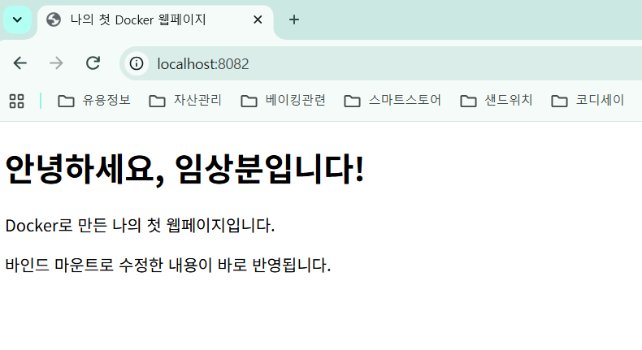
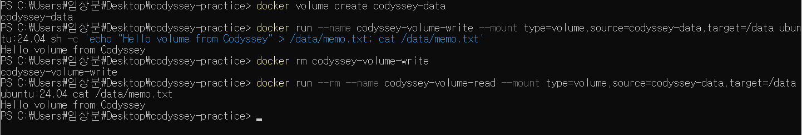

# 🛠️ 내 컴퓨터에 개발자용 작업실 꾸미기

Windows에서 개발 도구를 준비하고, Docker로 웹페이지를 실행한 실습 기록입니다.
명령 실행 결과는 `evidence` 폴더에, 주요 화면은 `images` 폴더에 보관했습니다.

## 1. 프로젝트 목표

- 터미널에서 파일과 폴더를 다룬다.
- Linux 파일 권한을 확인하고 변경한다.
- Docker 이미지와 컨테이너를 사용한다.
- Dockerfile로 나만의 웹 서버 이미지를 만든다.
- 포트 연결을 통해 웹페이지에 접속한다.
- 바인드 마운트와 볼륨의 차이를 확인한다.
- 데이터를 백업하고 복원한다.
- GitHub에 실습 과정과 결과를 기록한다.

## 2. 실행 환경

| 항목 | 환경 |
| --- | --- |
| 운영체제 | Windows 11 |
| 터미널 | PowerShell 7.6.9 |
| Git | 2.56.0.windows.4 |
| VS Code | 1.145.2 |
| Docker 클라이언트·서버 | 29.9.2 |
| Docker 실행 환경 | Docker Desktop, WSL2 기반 Linux 컨테이너 |
| Ubuntu | 24.04.5 LTS |
| 웹 서버 기반 이미지 | nginx:stable |

환경 확인에 사용한 명령입니다.

```powershell
$PSVersionTable.PSVersion
git --version
code --version
docker --version
docker info
```

`docker info`에서 확인한 주요 결과입니다.

```text
Server Version: 29.9.2
Operating System: Docker Desktop
OSType: linux
Kernel Version: 6.18.54.1-microsoft-standard-WSL2
```

Docker 클라이언트 버전뿐 아니라 Server 정보도 출력되어,
Docker 엔진과 정상적으로 연결된 것을 확인했습니다.

- [전체 실행 로그](evidence/)

## 3. 프로젝트 구조

```text
ai-codyssey-submit/
├── Dockerfile
├── index.html
├── README.md
├── images/
├── evidence/
└── terminal-practice/
```

| 파일·폴더 | 역할 |
| --- | --- |
| Dockerfile | 웹 서버 이미지 빌드 설정 |
| index.html | 웹페이지 내용 |
| README.md | 실습 방법과 결과 정리 |
| images | 실행 화면 캡처 |
| evidence | 명령과 터미널 출력 |
| terminal-practice | 파일 조작 실습 자료 |

실제 구조는 PowerShell에서 확인할 수 있습니다.

```powershell
tree.com /F
```

## 4. 터미널 기본 조작

파일과 폴더의 생성·복사·이름 변경·이동·삭제를 실습했습니다.

### 입력한 주요 명령

```powershell
Get-Location

New-Item -ItemType Directory -Path terminal-practice
Set-Location .\terminal-practice

New-Item -ItemType File -Path empty.txt
Set-Content -Path hello.txt -Value "Hello, Codyssey!"
Get-Content .\hello.txt

New-Item -ItemType File -Path hidden.txt
attrib +h .\hidden.txt
Get-ChildItem
Get-ChildItem -Force

Copy-Item .\hello.txt -Destination .\hello-copy.txt
Rename-Item .\hello-copy.txt -NewName renamed.txt

New-Item -ItemType Directory -Path archive
Move-Item .\renamed.txt -Destination .\archive\
Get-Content .\archive\renamed.txt

Remove-Item .\archive\renamed.txt
Remove-Item .\archive
Test-Path .\archive

Set-Location ..
```

### 확인 결과

파일 내용 확인:

```text
Hello, Codyssey!
```

폴더 삭제 확인:

```text
False
```

- `Get-ChildItem`에서는 숨김 파일이 보이지 않았습니다.
- `Get-ChildItem -Force`에서는 `hidden.txt`가 표시됐습니다.
- 복사·이동한 파일에도 원본 내용이 유지됐습니다.
- 삭제 후 `Test-Path`가 `False`를 반환했습니다.

- [명령과 실제 출력](evidence/02-terminal.txt)

## 5. Linux 파일 권한

Ubuntu 컨테이너 안에서 파일과 폴더의 권한을 변경했습니다.

### 사용한 명령

실습 파일이 있는 디렉터리에서 실행했습니다.

```bash
ls -ld file.txt mydir

chmod 600 file.txt
chmod 700 mydir

ls -ld file.txt mydir
```

### 변경 전



### 변경 후



### 권한의 의미

권한은 소유자·그룹·기타 사용자 순서로 표시합니다.
`r=4`, `w=2`, `x=1`을 더해서 숫자로 표현합니다.

| 대상 | 권한 | 의미 |
| --- | --- | --- |
| file.txt | `600`, `-rw-------` | 소유자만 읽기·쓰기 가능 |
| mydir | `700`, `drwx------` | 소유자만 목록 조회·내용 변경·진입 가능 |

이 권한은 Windows 파일이 아닌 Linux 컨테이너 내부 파일에 적용했습니다.

## 6. Docker 기본 실행과 운영

### 6.1 hello-world 실행

```powershell
docker run --name codyssey-hello hello-world
docker ps -a --filter name=codyssey-hello
```

컨테이너 목록에서 다음 상태를 확인했습니다.

```text
Exited (0)
```

`hello-world`는 실행 결과를 출력한 뒤 종료되는 프로그램이므로
`Exited (0)`은 정상 종료를 뜻합니다.



### 6.2 이미지와 컨테이너 목록

```powershell
docker images
docker ps
docker ps -a
```

- `docker images`: 이미지 목록
- `docker ps`: 실행 중인 컨테이너
- `docker ps -a`: 종료된 컨테이너까지 포함한 목록

### 6.3 Ubuntu 접속

```powershell
docker start codyssey-linux
docker exec -it codyssey-linux bash
```

컨테이너 안에서 실행했습니다.

```bash
echo "Hello from container"
cat /etc/os-release
exit
```

주요 출력:

```text
Hello from container
PRETTY_NAME="Ubuntu 24.04.5 LTS"
```

### 6.4 로그·리소스·중지·재시작

```powershell
docker logs codyssey-linux
docker stats --no-stream codyssey-linux

docker stop codyssey-linux
docker ps -a --filter name=codyssey-linux

docker start codyssey-linux
docker ps --filter name=codyssey-linux
```

리소스 확인 결과:

```text
CPU: 0.00%
Memory: 5.035MiB / 3.68GiB
```

실습 시점의 값이며 실행 상황에 따라 달라집니다.

- `docker logs`는 비어 있었습니다.
- `docker exec`에서 실행한 출력은 기본 컨테이너 로그와 구분됩니다.
- 중지 후 `Exited (137)`, 재시작 후 `Up`을 확인했습니다.
- 종료 코드 137은 SIGKILL로 종료된 경우를 뜻합니다.
  `docker stop`이 대기 후 강제 종료했을 가능성이 있으며,
  이 코드만으로 메모리 부족이라고 단정하지 않았습니다.

### exit와 exec에서 관찰한 차이

처음 실행한 주 프로세스인 Bash에서 `exit`하면 컨테이너가 종료됩니다.
반면 `docker exec`로 추가 실행한 Bash에서 나와도
기존 주 프로세스가 살아 있으면 컨테이너는 계속 실행됩니다.

이번 실습에서는 `exec`에서 나온 뒤에도 `Up` 상태를 확인했습니다.

- [Docker 운영 명령과 실제 출력](evidence/05-docker-operations.txt)

## 7. Dockerfile로 웹 서버 이미지 제작

### 선택한 기반과 커스텀 내용

- **기반 이미지**: `nginx:stable`
- **선택 이유**: 정적 HTML 페이지를 제공하는 웹 서버가 준비되어 있기 때문입니다.
- **변경 내용**: 기본 페이지를 직접 작성한 `index.html`로 교체했습니다.
- **목적**: 내가 만든 페이지를 Docker 컨테이너에서 제공하기 위해서입니다.

### Dockerfile

```dockerfile
FROM nginx:stable
COPY index.html /usr/share/nginx/html/index.html
```

### 빌드 명령

Dockerfile과 index.html이 있는 프로젝트 폴더에서 실행했습니다.

```powershell
docker build --progress=plain -t codyssey-web:v1 .
docker images codyssey-web
```

빌드 출력에서 확인한 주요 내용입니다.

```text
COPY index.html /usr/share/nginx/html/index.html
naming to docker.io/library/codyssey-web:v1 done
```

- [빌드 명령과 실제 출력](evidence/06-web-build.txt)

### 경로와 재현성

- 마지막 `.`은 현재 폴더를 빌드 컨텍스트로 사용한다는 뜻입니다.
- `COPY`의 원본 `index.html`은 빌드 컨텍스트 기준 상대 경로입니다.
- 목적지는 이미지 내부의 절대 경로입니다.
- `/usr/share/nginx/html`은 Nginx의 기본 웹 문서 위치입니다.
- 다른 컴퓨터에서도 같은 파일 구조로 저장소 루트에서 빌드해야 합니다.
- `nginx:stable`은 시간이 지나면 내용이 바뀔 수 있습니다.
  완전히 동일한 기반 이미지가 필요하면 검증한 digest를 고정해야 합니다.

### 이미지와 컨테이너의 차이

이미지는 실행에 필요한 파일과 설정을 담은 기반이고,
컨테이너는 그 이미지로 만든 실행 인스턴스입니다.

한 이미지로 여러 컨테이너를 만들 수 있습니다.
컨테이너 내부 파일을 변경해도 원본 이미지가 바뀌지는 않습니다.

이번처럼 HTML을 `COPY`한 경우, 파일을 수정한 뒤 다시 빌드하고
컨테이너를 새로 만들어야 변경 사항이 반영됩니다.

## 8. 포트 연결과 웹페이지 접속

### 실행 명령

```powershell
docker run -d --name codyssey-web-8080 -p 127.0.0.1:8080:80 codyssey-web:v1

docker run -d --name codyssey-web-8081 -p 127.0.0.1:8081:80 codyssey-web:v1
```

### 확인 명령

```powershell
docker ps
curl.exe -i http://localhost:8080/
curl.exe -i http://localhost:8081/
```

### 접속 결과

- http://localhost:8080
- http://localhost:8081

두 주소에서 같은 웹페이지가 표시되는 것을 확인했습니다.





- [8080 실행 및 응답 로그](evidence/07-web-run.txt)
- [8081 실행 및 응답 로그](evidence/08-second-port.txt)

### 포트 연결 원리

컨테이너는 보통 호스트와 분리된 네트워크 네임스페이스를 사용합니다.
따라서 컨테이너의 80번 포트는 호스트의 80번 포트와 구분됩니다.

```text
브라우저 → 호스트 127.0.0.1:8080 → 컨테이너 80 → Nginx
```

`-p 127.0.0.1:8080:80`으로 내 컴퓨터의 로컬 주소 8080 포트를
컨테이너의 80 포트에 연결했습니다.

Windows에서는 Docker Desktop이 Linux 실행 환경과
호스트 사이의 네트워크 연결을 처리합니다.

## 9. 바인드 마운트

호스트의 index.html을 컨테이너에 직접 연결했습니다.

### 실행 명령

프로젝트 루트의 PowerShell에서 실행했습니다.

```powershell
docker run -d --name codyssey-web-live -p 127.0.0.1:8082:80 --mount "type=bind,source=$($PWD.Path)/index.html,target=/usr/share/nginx/html/index.html,readonly" codyssey-web:v1
```

### 확인 방법

1. http://localhost:8082 에 접속했습니다.
2. VS Code에서 index.html의 문구를 수정하고 저장했습니다.
3. 이미지를 다시 빌드하지 않고 브라우저를 새로고침했습니다.
4. 변경된 문구가 반영되는지 확인했습니다.

```powershell
curl.exe -i http://localhost:8082/
```





- [명령과 실제 응답](evidence/09-bind-mount.txt)

### 배운 내용

- `source`는 호스트의 파일 위치입니다.
- `$PWD.Path`는 현재 호스트 폴더의 절대 경로입니다.
- `target`은 컨테이너 내부 경로입니다.
- `readonly`는 컨테이너에서 원본 파일을 수정하지 못하게 합니다.
- 마운트한 파일은 해당 위치에 있던 이미지의 파일을 가립니다.
- 다른 컴퓨터에서도 index.html이 있는 폴더에서 실행해야 합니다.

8080·8081은 이미지에 복사된 HTML을 사용하고,
8082는 연결된 호스트 파일을 사용한다는 차이가 있습니다.

## 10. Docker 볼륨 영속성

컨테이너를 삭제해도 데이터가 남는지 확인했습니다.

### ① 볼륨 생성

```powershell
docker volume create codyssey-data
```

### ② 데이터 저장 및 확인

```powershell
docker run --name codyssey-volume-write --mount type=volume,source=codyssey-data,target=/data ubuntu:24.04 sh -c 'echo "Hello volume from Codyssey" > /data/memo.txt; cat /data/memo.txt'
```

### ③ 컨테이너 삭제

```powershell
docker rm codyssey-volume-write
```

### ④ 새 컨테이너에서 데이터 확인

```powershell
docker run --rm --name codyssey-volume-read --mount type=volume,source=codyssey-data,target=/data ubuntu:24.04 cat /data/memo.txt
```

출력:

```text
Hello volume from Codyssey
```

### ⑤ 볼륨 정보 확인

```powershell
docker volume inspect codyssey-data
```



- [생성·삭제·조회 명령과 실제 출력](evidence/10-volume.txt)

### 배운 내용

컨테이너 내부 쓰기 계층의 데이터는 컨테이너 삭제 시 사라집니다.
볼륨은 컨테이너와 별도로 관리되므로,
같은 볼륨을 새 컨테이너에 연결하면 데이터를 다시 읽을 수 있습니다.

이번 실습에서는 단순 재시작이 아니라
컨테이너를 삭제한 뒤 새 컨테이너로 확인했습니다.

## 11. 데이터 백업과 복원

볼륨도 삭제나 저장 장치 문제로 데이터를 잃을 수 있으므로
백업 파일을 만들고 새 볼륨에 복원했습니다.

### 백업

```powershell
New-Item -ItemType Directory -Force -Path backups

docker run --rm --mount type=volume,source=codyssey-data,target=/data,readonly --mount "type=bind,source=$($PWD.Path)/backups,target=/backup" ubuntu:24.04 tar -czf /backup/codyssey-data.tar.gz -C /data .

Get-Item .\backups\codyssey-data.tar.gz
```

확인한 백업 파일:

```text
파일 이름: codyssey-data.tar.gz
파일 크기: 173바이트
```

### 새 볼륨에 복원

```powershell
docker volume create codyssey-restored

docker run --rm --mount type=volume,source=codyssey-restored,target=/data --mount "type=bind,source=$($PWD.Path)/backups,target=/backup,readonly" ubuntu:24.04 tar -xzf /backup/codyssey-data.tar.gz -C /data

docker run --rm --mount type=volume,source=codyssey-restored,target=/data,readonly ubuntu:24.04 cat /data/memo.txt
```

복원 확인 결과:

```text
Hello volume from Codyssey
```

- [백업·복원 명령과 실제 출력](evidence/11-backup.txt)

이번 실습은 정적 텍스트 파일을 대상으로 했습니다.
실제 서비스는 쓰기를 멈추거나 서비스에 맞는 백업 도구를 사용해야 합니다.

중요한 데이터는 정기적으로 백업하고,
원본과 다른 저장 장치나 저장소에도 보관해야 합니다.

## 12. Git 설정과 GitHub 연결

### 설정 확인

```powershell
git config --get user.name
git config --get user.email
git config --get init.defaultBranch
```

전체 설정은 다음 명령으로 확인할 수 있습니다.
출력을 공개할 때는 토큰·인증 정보 등이 없는지 먼저 확인합니다.

```powershell
git config --list
```

Git 설정 확인 결과:

```text
사용자 이름: SangboonLim
새 저장소의 기본 브랜치: main
현재 브랜치: main
```

### 기존 저장소 연결

기존 커밋을 유지하기 위해 저장소를 복제했습니다.

```powershell
git clone https://github.com/limsangboon/ai-codyssey.git ai-codyssey-submit
cd ai-codyssey-submit

git status
git remote -v
```

확인 결과:

```text
On branch main
Your branch is up to date with 'origin/main'.
```

원격 주소:

```text
origin  https://github.com/limsangboon/ai-codyssey.git (fetch)
origin  https://github.com/limsangboon/ai-codyssey.git (push)
```

복제 후 새 실습 자료를 복사했습니다.
Git은 Dockerfile과 index.html의 변경,
새 실행 로그와 이미지 파일을 인식했습니다.

- [Git 설정 및 원격 연결 로그](evidence/12-git-submit.txt)

공개 저장소 복제 성공과 GitHub 업로드 인증 성공은 구분합니다.
업로드 완료 후 실제 push 결과와 제출 커밋 링크를 추가할 예정입니다.

## 13. 트러블슈팅

### 사례 1. PowerShell 명령에 공백 누락

잘못 입력한 명령:

```powershell
Get-ChildItem-Force
```

오류:

```text
명령 이름으로 인식되지 않습니다.
```

원인은 명령과 옵션 사이의 공백 누락이었습니다.

수정:

```powershell
Get-ChildItem -Force
```

수정 후 숨김 파일을 포함한 목록이 표시됐습니다.

### 사례 2. Docker 하위 명령을 옵션으로 입력

잘못 입력한 명령:

```powershell
docker --info
```

오류:

```text
unknown flag: --info
```

`info`는 옵션이 아니라 하위 명령이므로 다음처럼 수정했습니다.

```powershell
docker info
```

수정 후 Client와 Server 정보가 표시됐습니다.

### 사례 3. System32에서 로그 저장 시도

`C:\Windows\System32`에서 다음 명령을 실행했습니다.

```powershell
Start-Transcript -Path .\evidence\04-hello-world.txt -Append
```

결과:

```text
Access to the path 'C:\Windows\System32\evidence' is denied.
```

상대 경로가 현재 폴더를 기준으로 해석된 것이 원인이었습니다.
관리자 권한을 사용하는 대신 실습 폴더로 이동했습니다.

```powershell
Set-Location "$HOME\Desktop\codyssey-practice"
```

그다음 기록을 다시 시작했습니다.

### 사례 4. 기록 중이 아닐 때 Stop-Transcript 실행

오류:

```text
호스트가 현재 전사 중이 아닙니다.
```

현재 창에서 기록이 실행되고 있지 않다는 뜻이었습니다.
필요한 경우 `Start-Transcript`로 기록을 시작했습니다.

### 사례 5. Linux 경로를 PowerShell에서 사용

입력한 명령:

```powershell
docker exec codyssey-linux find / -name file.txt -type f 2>/dev/null
```

오류:

```text
Could not find a part of the path 'C:\dev\null'.
```

PowerShell이 `/dev/null`을 호스트 경로로 처리한 것이 원인이었습니다.
리다이렉션을 제거하여 실행했습니다.

```powershell
docker exec codyssey-linux find / -type f -name file.txt
```

경로 오류는 해소됐지만 검색 결과는 없었습니다.
검색 명령 오류와 파일이 없는 결과를 구분했습니다.

### 참고: 포트 충돌 진단 방법

아래는 포트 충돌 발생 시 사용할 참고 절차입니다.
이번 실습에서 실제 해결한 사례로 기록하지는 않았습니다.

컨테이너의 포트 사용 확인:

```powershell
docker ps --format "table {{.Names}}\t{{.Ports}}"
```

Windows에서 8080 포트 사용 확인:

```powershell
Get-NetTCPConnection -LocalPort 8080 -State Listen |
    Select-Object LocalAddress, LocalPort, OwningProcess
```

확인된 PID로 프로그램 조회:

```powershell
Get-Process -Id <확인한PID>
```

사용 주체를 확인한 뒤 다음 방법 중 하나를 선택합니다.

- 본인 실습 컨테이너라면 `docker stop <이름>`으로 중지합니다.
- 일반 프로그램이면 정상 종료합니다.
- 계속 필요한 프로그램이면 새 컨테이너의 호스트 포트를 바꿉니다.

## 14. 처음부터 웹페이지 재실행하기

Docker Desktop을 실행한 뒤 PowerShell에서 진행합니다.

```powershell
git clone https://github.com/limsangboon/ai-codyssey.git
cd ai-codyssey

docker build -t codyssey-web:v1 .

docker run -d --name codyssey-replay -p 127.0.0.1:8080:80 codyssey-web:v1

curl.exe -i http://localhost:8080/
```

브라우저에서 http://localhost:8080 에 접속합니다.

- 같은 이름의 컨테이너가 있으면 새 이름을 사용합니다.
- 8080 포트가 사용 중이면 다른 호스트 포트를 사용합니다.
- 바인드 마운트는 9절, 볼륨은 10절의 명령으로 재현합니다.
- 백업·복원은 11절의 명령으로 확인합니다.

## 15. 보안 및 개인정보 보호

- 로그와 이미지에 비밀번호·토큰·개인키·인증 코드가 없는지 확인합니다.
- 필요한 개인정보는 `[가림]`으로 표시합니다.
- 민감정보가 노출됐다면 문서에서 제거하고 해당 인증 정보를 폐기·재발급합니다.
- 실제 데이터가 포함된 백업은 공개 저장소에 올리지 않습니다.

## 16. 제출 전 체크리스트

- [o] 프로젝트 목표·실행 환경·파일 구조를 작성했다.
- [o] 터미널 명령과 출력 로그가 연결된다.
- [o] 권한 변경 전후 이미지가 정상 표시된다.
- [o] hello-world 실행 결과가 있다.
- [o] 컨테이너·이미지 목록과 빌드 로그가 있다.
- [o] 8080·8081 접속 증거가 있다.
- [o] 바인드 마운트 변경 전후 증거가 있다.
- [o] 컨테이너 삭제 후 볼륨 데이터 유지 증거가 있다.
- [o] 백업·복원 결과를 확인했다.
- [o] Git 설정과 GitHub 업로드 증거가 있다.
- [o] 모든 이미지와 로그 링크가 정상적으로 열린다.
- [o] 민감정보와 작성 안내 문구를 확인했다.